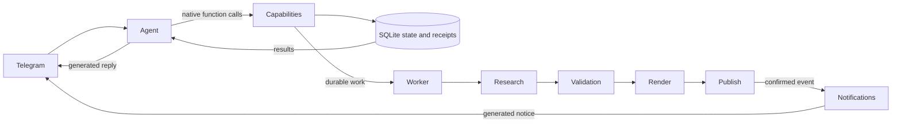

# Architecture

Slop Bot has one conversational agent and a durable autonomous production worker. Telegram is the agent's interface, not a parallel command interpreter.

## Conversation

Every message, including the budget menu entry, goes directly to the same Cloudflare Mistral agent. It receives live state, conversation memory and native function definitions. The model may read more evidence or call a capability, consume its result, then write a normal reply. There is no phrase classifier, separate action-selection inference, or reply-template layer. `chat.py` only stores conversation memory and preferences.

`agent.py` owns the bounded function-calling loop. `agent_tools.py` exposes operational reads, run/pause, publishing, schedule, budget reduction, saved preferences and work enqueueing. Schemas describe API inputs, not user command phrases. Backend functions enforce access, typed arguments, spending limits and publication invariants. Neither prompts nor model output can grant credentials or arbitrary shell access.

Tool receipts persist before the next inference. Accepted asynchronous work is distinct from completed work. Stable child request IDs deduplicate enqueueing and allow multiple distinct tasks in one conversation turn. Production stays in the worker so chat does not wait for video rendering. A failed response never causes automatic replay of completed tools.

The model supports native function calls through the Workers AI binding. Worker transport preserves tool definitions and messages instead of forcing JSON conversational responses. Generated notifications are cached once per event and delivered according to recipient policy; failed generation remains pending for bounded retry.

## Autonomous production

Daily primary-source research proposes diagnostic concepts and technical diagrams. Independent source/executable checks, semantic novelty review, a 50-published-Reel concept cooldown and all-history exact-claim checks can reject a candidate. Rewording or renumbering is not novelty. Source reviews remain fallible and are not described as executable proof.

The worker stages one approved Reel and refills after consumption, subject to quota, quality and bounded attempts. Scheduled posting consumes ready work first. Jobs, usage reservations, source evidence, experiments and outcomes survive process restarts. The daemon sleeps to deadlines and wakes on a durable-inbox signal; it does not poll every minute.

Models may propose one-factor content experiments. Adoption requires comparable-age measurements, minimum samples and recorded evidence. This updates editorial policy, not model weights. There is no promise of viral performance or indefinite operation without credential renewal.

## Reliability and cost

All paid inference reserves integer microdollars before submission. The rolling monthly and per-job caps include uncertain charges. Cloudflare inference uses eligible Free-plan models, a shared conservative quota and provider-reported usage reconciliation, with no paid fallback. No extra local model or database service is required.

Publication states distinguish rejected container creation, processing and an uncertain final publish outcome. A definite client rejection restores the staged job; transport uncertainty remains held. Never submit another post to guess whether an unknown publish succeeded. Meta access checks pause publication on rejection and expose the reason to the agent; operator resume rechecks access.

Media is temporary staging. Confirmed publication or preview delivery removes local media; metadata, receipts and Telegram file IDs remain. Database backups are local and bounded; off-host disaster recovery is not implemented. Dependencies and account permissions can change, and provider outages can prevent replies or production.

## Verification and references

Tests cover the actual native function-call/result/reply cycle, executor state changes before confirmation, read-only conversation without a command router, enqueue deduplication, access controls, budget races, publication uncertainty, source proofs, media cleanup and repository hygiene. Live-model checks run against isolated database copies with side effects disabled.

Primary design references: [Cloudflare function calling](https://developers.cloudflare.com/workers-ai/features/function-calling/traditional/), [Mistral model API](https://developers.cloudflare.com/workers-ai/models/mistral-small-3.1-24b-instruct/), [effective agents](https://www.anthropic.com/engineering/building-effective-agents), and [AWS idempotent APIs](https://aws.amazon.com/builders-library/making-retries-safe-with-idempotent-APIs/).

Operational state is projected from the ledger, authorization health, and current settings.
Historical job failures are available through activity inspection, rather than included as
current queue failures. Job status/error transitions are audited in `job_events`.
Phase-specific incidents have explicit open/resolved lifecycles; a successful credential
health check resolves access incidents without silently enabling publication.

The conversation context includes recent operator messages and current state. Prior AI
operational claims are not treated as evidence. Native capability descriptions distinguish
enabling the schedule from submitting an immediate publication request. Durable worker
receipts distinguish acceptance from completion, and uncertain publication outcomes remain
held against duplicate submission.

The shared daily free allowance remains capped independently of category allocations.
Default allocations allow 4,500 neurons for chat/control and 3,000 for research/editorial;
provider-reported usage reconciles reservations when available. No paid fallback is enabled.
